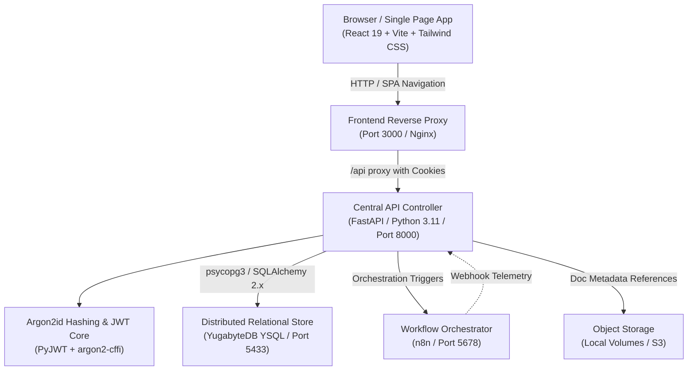
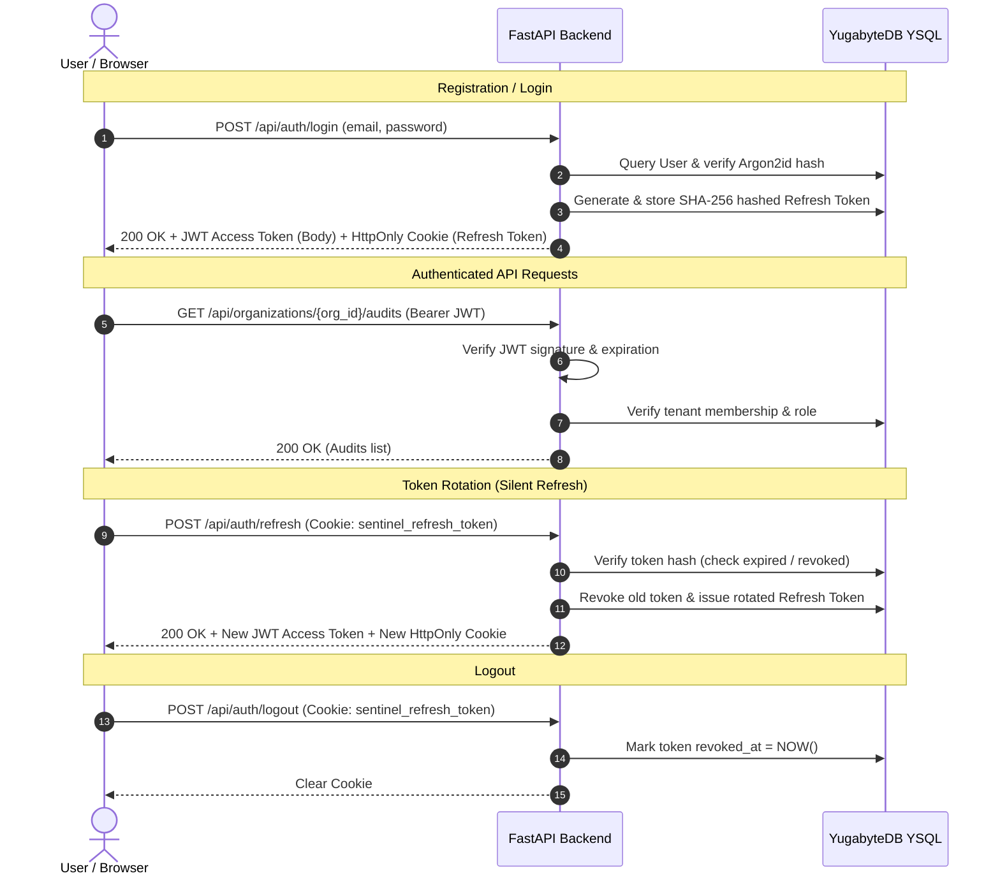
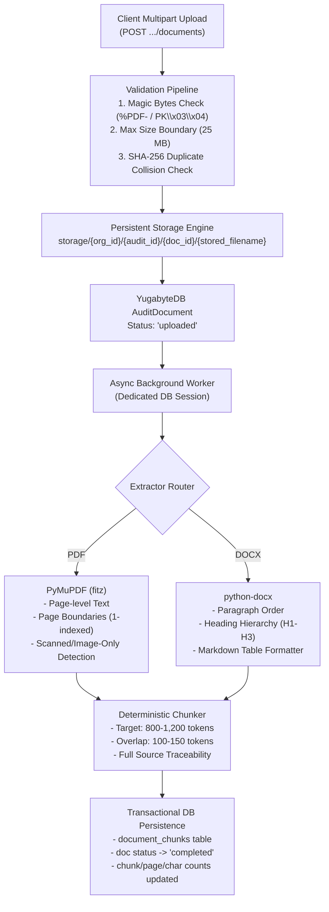
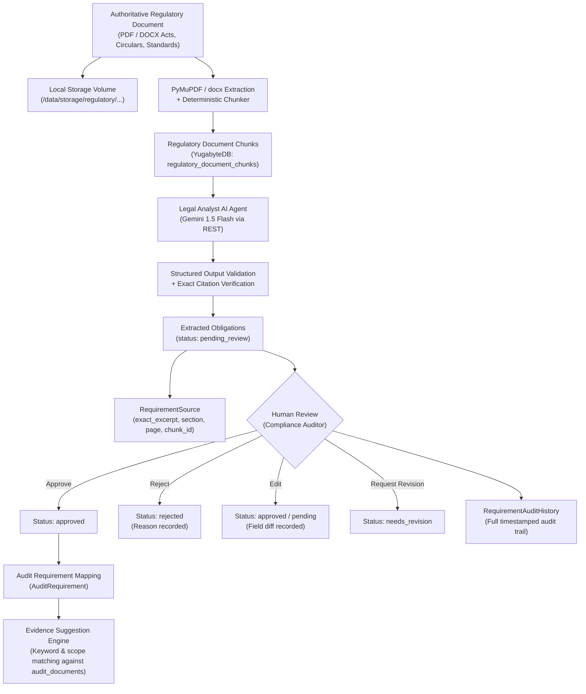
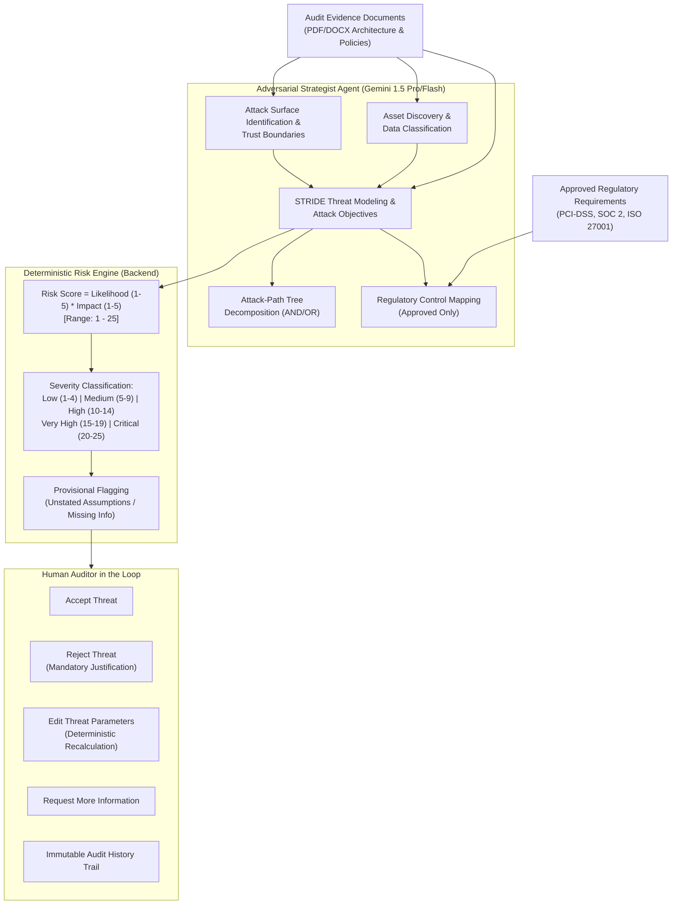

# Compliance Sentinel — Security Posture & Compliance SaaS

**Compliance Sentinel Enterprise v4.0** is an enterprise-grade multi-tenant AI-powered compliance auditing platform. It monitors and validates infrastructure and application workloads against global regulatory frameworks (SOC 2, ISO 27001, HIPAA, PCI-DSS, NIST CSF, EU AI Act) using an ensemble of autonomous LLM auditor models.

---

## 1. System Architecture Overview



- **Frontend**: React 19, Vite, TypeScript, Tailwind CSS, Lucide Icons, served via Nginx with HTML5 push-state routing and API reverse-proxying.
- **Backend API**: Python 3.11, FastAPI, Pydantic v2, dependency injection for database sessions and RBAC.
- **Authentication**: Argon2id password hashing, short-lived signed JWT access tokens, and cryptographically hashed refresh tokens transported via `HttpOnly`, `SameSite=Lax` cookies.
- **Database**: YugabyteDB YSQL (PostgreSQL 15-compatible distributed relational database).
- **ORM & Migrations**: SQLAlchemy 2.x typed `Mapped` declarative models + Alembic.
- **Workflow Orchestration**: n8n service (isolated from frontend; all orchestration coordinated via FastAPI).
- **Containerization**: Docker Compose with multi-stage image builds, named persistent volumes, service health checks, and a bridge network.

---

## 2. Authentication, Tenancy & RBAC (Milestone 2)

### 2.1 Security & Session Lifecycle



### 2.2 Supported Organization Roles

| Role | Permissions & Capabilities |
|---|---|
| **`owner`** | Full administrative control. Can create/manage audits, provision runs, manage organization settings, invite/remove members, and assign/demote other owners. Cannot be demoted or removed if they are the last owner. |
| **`admin`** | User management and audit administration. Can manage non-owner members, update organization name, and create/manage audits and runs. Cannot promote themselves to owner. |
| **`auditor`** | Operational audit specialist. Can create audits, update audit configurations, dispatch audit execution runs, and view reports. |
| **`analyst`** | Read access to audits and runs; can manage findings, evidence, and adjudication responses. |
| **`viewer`** | Strictly read-only access to organization audits, compliance dashboards, telemetry, and reports. |

---

## 3. API Endpoints Reference

### 3.1 Authentication (`/api/auth`)

#### `POST /api/auth/register`
Creates a user, organization, and owner membership in a single transactional unit. Sets `HttpOnly` refresh cookie.
```json
// Request Body
{
  "full_name": "Elena Vance",
  "email": "elena.vance@acme-financial.com",
  "password": "SecurePassword2026!",
  "organization_name": "Acme Financial Global"
}

// Response: 201 Created
{
  "access_token": "eyJhbGciOi...",
  "token_type": "bearer",
  "expires_in": 1800,
  "user_id": "7839d873-65f6-4b87-91f4-2d0729e43d44",
  "email": "elena.vance@acme-financial.com",
  "full_name": "Elena Vance",
  "organization_id": "3f24ed73-3817-470f-adb7-005ecd7069c9",
  "organization_name": "Acme Financial Global",
  "role": "owner"
}
```

#### `POST /api/auth/login`
Authenticates credentials with Argon2id and returns an access token + sets refresh cookie.
```json
// Request Body
{
  "email": "elena.vance@acme-financial.com",
  "password": "SecurePassword2026!"
}
```

#### `GET /api/auth/me`
Returns current user profile and array of active tenant memberships.
```json
// Headers: Authorization: Bearer <access_token>
// Response: 200 OK
{
  "id": "7839d873-65f6-4b87-91f4-2d0729e43d44",
  "email": "elena.vance@acme-financial.com",
  "full_name": "Elena Vance",
  "is_active": true,
  "organizations": [
    {
      "organization_id": "3f24ed73-3817-470f-adb7-005ecd7069c9",
      "organization_name": "Acme Financial Global",
      "organization_slug": "acme-financial-global",
      "role": "owner"
    }
  ]
}
```

#### `POST /api/auth/refresh`
Rotates refresh tokens and returns a fresh access token. Protects against token reuse.

#### `POST /api/auth/logout`
Revokes active refresh session in the database and clears the browser cookie.

---

### 3.2 Organization Management (`/api/organizations`)

- `GET /api/organizations` — List organizations the user belongs to.
- `POST /api/organizations` — Create a new organization (requesting user becomes `owner`).
- `GET /api/organizations/{org_id}` — Get organization metadata (requires membership).
- `PATCH /api/organizations/{org_id}` — Update organization details (`owner`, `admin`).
- `GET /api/organizations/{org_id}/members` — List members and their roles.
- `POST /api/organizations/{org_id}/members` — Add a registered user to the organization.
- `PATCH /api/organizations/{org_id}/members/{user_id}` — Update member role (enforces last-owner & self-promotion guardrails).
- `DELETE /api/organizations/{org_id}/members/{user_id}` — Remove member from organization.

---

### 3.3 Audit & Run Management (`/api/organizations/{org_id}/audits`)

- `POST /api/organizations/{org_id}/audits` — Create an audit case (`owner`, `admin`, `auditor`).
- `GET /api/organizations/{org_id}/audits` — List audits with pagination (`page`, `size`), text search (`search`), and status filter (`status`).
- `GET /api/organizations/{org_id}/audits/{audit_id}` — Retrieve audit details, execution metrics, and run summary.
- `PATCH /api/organizations/{org_id}/audits/{audit_id}` — Update audit properties.
- `DELETE /api/organizations/{org_id}/audits/{audit_id}` — Soft-delete / archive audit preserving run history.
- `POST /api/organizations/{org_id}/audits/{audit_id}/runs` — Allocate next sequential `run_number` and queue execution.
- `GET /api/organizations/{org_id}/audits/{audit_id}/runs` — List all execution runs ordered by `run_number DESC`.
- `GET /api/organizations/{org_id}/audits/{audit_id}/runs/{run_id}` — Retrieve details of a specific execution run.

---

### 3.4 Document Management & Ingestion (`/api/organizations/{org_id}/audits/{audit_id}/documents`)

All endpoints enforce multi-tenant organization isolation, audit ownership verification, and RBAC (`owner`, `admin`, `auditor`, `analyst`, and `viewer`).

| Method | Endpoint | Allowed Roles | Description |
|---|---|---|---|
| `POST` | `/api/organizations/{org_id}/audits/{audit_id}/documents` | `owner`, `admin`, `auditor`, `analyst` | Upload PDF or DOCX file (max 25MB). Validates magic bytes, checks duplicate SHA-256 within the audit, persists to disk, and triggers background extraction & chunking. |
| `GET` | `/api/organizations/{org_id}/audits/{audit_id}/documents` | All members | List active documents with pagination (`page`, `size`), search by filename (`search`), and status filter (`status`). |
| `GET` | `/api/organizations/{org_id}/audits/{audit_id}/documents/{doc_id}` | All members | Retrieve document metadata, page/chunk counts, and upload details. |
| `GET` | `/api/organizations/{org_id}/audits/{audit_id}/documents/{doc_id}/status` | All members | Retrieve real-time processing status, errors, and chunk statistics. |
| `GET` | `/api/organizations/{org_id}/audits/{audit_id}/documents/{doc_id}/text` | All members | Retrieve full extracted plain-text stream for preview. |
| `GET` | `/api/organizations/{org_id}/audits/{audit_id}/documents/{doc_id}/chunks` | All members | Retrieve paginated chunks with source traceability (page numbers, section titles, and character offsets). |
| `GET` | `/api/organizations/{org_id}/audits/{audit_id}/documents/{doc_id}/download` | All members | Securely download the original stored document with sanitized attachment headers. |
| `POST` | `/api/organizations/{org_id}/audits/{audit_id}/documents/{doc_id}/retry` | `owner`, `admin`, `auditor`, `analyst` | Re-queue and re-process failed documents with concurrency protection. |
| `DELETE` | `/api/organizations/{org_id}/audits/{audit_id}/documents/{doc_id}` | `owner`, `admin`, `auditor` | Soft-delete document, invalidating all subsequent access. |

#### cURL Examples:

**1. Upload a Document:**
```bash
curl -X POST "http://localhost:8000/api/organizations/{org_id}/audits/{audit_id}/documents" \
  -H "Authorization: Bearer $ACCESS_TOKEN" \
  -F "file=@soc2_policy.pdf;type=application/pdf"
```

**2. List Documents:**
```bash
curl -X GET "http://localhost:8000/api/organizations/{org_id}/audits/{audit_id}/documents?status=completed&page=1&size=20" \
  -H "Authorization: Bearer $ACCESS_TOKEN"
```

**3. Inspect Extracted Text:**
```bash
curl -X GET "http://localhost:8000/api/organizations/{org_id}/audits/{audit_id}/documents/{doc_id}/text" \
  -H "Authorization: Bearer $ACCESS_TOKEN"
```

**4. Inspect Chunks with Traceability:**
```bash
curl -X GET "http://localhost:8000/api/organizations/{org_id}/audits/{audit_id}/documents/{doc_id}/chunks?page=1&size=10" \
  -H "Authorization: Bearer $ACCESS_TOKEN"
```

**5. Secure Download:**
```bash
curl -O -J -X GET "http://localhost:8000/api/organizations/{org_id}/audits/{audit_id}/documents/{doc_id}/download" \
  -H "Authorization: Bearer $ACCESS_TOKEN"
```

**6. Retry Failed Processing:**
```bash
curl -X POST "http://localhost:8000/api/organizations/{org_id}/audits/{audit_id}/documents/{doc_id}/retry" \
  -H "Authorization: Bearer $ACCESS_TOKEN"
```

**7. Delete Document:**
```bash
curl -X DELETE "http://localhost:8000/api/organizations/{org_id}/audits/{audit_id}/documents/{doc_id}" \
  -H "Authorization: Bearer $ACCESS_TOKEN"
```

---

## 4. Document Ingestion & Processing Architecture (Milestone 3)



### 4.1 Key Implementation Details:
- **Binary Separation**: Binary files are never stored inside YugabyteDB. Files are written to persistent storage (`/data/storage` mounted as Docker volume `compliance_sentinel_storage_data`), and only metadata, status, metrics, and extracted chunks are saved to YugabyteDB.
- **Content Validation**: File validation inspects actual magic bytes rather than trusting client-provided filenames or MIME types (`%PDF-` for PDFs, `PK\x03\x04` and OOXML structure for DOCX).
- **Duplicate Prevention**: SHA-256 hash is computed in streaming chunks during upload. If an active document in the same audit possesses identical SHA-256, `409 Conflict` is returned.
- **Deterministic Chunking**:
  - Target size: 800–1,200 tokens (~3,200–4,800 characters)
  - Overlap: 100–150 tokens (~400–600 characters)
  - Traceability: Every chunk preserves `document_id`, `chunk_index`, `page_number` or `page_start-page_end`, `section_title`, and character offsets (`start_char_offset`, `end_char_offset`).
  - DOCX page numbers: Word documents lack physical pagination, so `page_number` is preserved as `None` without fabrication.
- **Scanned PDF Handling**: Scanned or image-only PDFs with no extractable text are automatically detected, flagged with `is_scanned_or_image_only: true` and `requires_ocr: true` in metadata, and reported transparently. OCR is not implemented in this milestone.

---

## 5. Frontend Application Features

- **Enterprise Login (`/login`)**: High-contrast, accessibility-tested authentication UI matching Compliance Sentinel brand aesthetics.
- **Organization Registration (`/register`)**: Self-serve workspace onboarding with real-time validation and instant credential generation.
- **Session Restoration & Auto-Refresh**: Seamless token lifecycle via centralized `apiClient` interceptor with queued retries on 401.
- **Multi-Tenant Workspace Switcher**: Quick dropdown in top navbar and sidebar allowing instant switching across tenant contexts.
- **Audit Case Dispatcher**: Modal dialog connecting directly to `POST /api/organizations/{org_id}/audits` and dispatching the first sequential run.
- **Live Audits Table**: Real-time assessments table connected to live YugabyteDB partitions, with server-side pagination, search, and empty state workflows.
- **Audit Documents & Evidence Hub**:
  - Drag-and-drop file upload zone with file picker and real-time validation (.pdf, .docx, max 25MB).
  - Document inventory displaying filename, file size, status badge, page count, and chunk count.
  - Document preview modal with dual tabs: full Extracted Text view (with copy button) and Chunks & Traceability view (with page references, section titles, and character offsets).
  - Secure original document downloads.
  - Safe document deletion with confirmation dialog.
  - Auto-polling status refresh when documents are being processed.

---

---

## 4. Regulatory Knowledge Base & Legal Analyst AI Agent (Milestone 4)

Compliance Sentinel implements a centralized **Regulatory Knowledge Base** and its first logical cognitive AI agent: the **Legal Analyst**.



### 4.1 Core Capabilities
1. **Authoritative Ingestion**: Uploads official regulatory texts (PDF/DOCX) into isolated regulatory directories, extracting text, calculating SHA-256 hashes, and chunking with page and section references.
2. **Legal Analyst Agent**:
   - Asynchronous Google Gemini integration using strict structured JSON schemas (`response_mime_type="application/json"`).
   - Strict anti-hallucination and evidence grounding prompts. Every requirement extracted MUST quote an exact, verbatim text excerpt.
   - Built-in prompt injection defense: untrusted document texts containing prompt injection or jailbreak attempts are treated strictly as passive data.
   - 21-category compliance taxonomy mapping (with "Other" fallback) and 5 obligation levels (`mandatory`, `conditional`, `recommended`, `informational`, `unclear`).
3. **Human Review Workflow**:
   - `Approve`: Confirms requirement for organization compliance auditing.
   - `Reject`: Discards non-normative or erroneous items with mandatory justification.
   - `Edit`: Modifies title, statement, category, or obligation level, recording before/after diffs.
   - `Request Revision`: Flags requirement for refinement.
   - Full immutable provenance in `RequirementAuditHistory`.
4. **Audit Requirement Mapping & Evidence Suggestions**:
   - Associates approved requirements with individual organization audits (`audit_requirements`).
   - Tracks per-audit applicability status (`applicable`, `not_applicable`, `requires_review`).
   - Suggests potentially relevant audit evidence documents (`audit_documents`) based on semantic keyword overlap.

### 4.2 Regulatory Knowledge Base API Reference

| Endpoint | Method | Role | Description |
|---|---|---|---|
| `/api/regulatory/frameworks` | `POST` | Any User | Register a new regulatory framework. |
| `/api/regulatory/frameworks` | `GET` | Any User | List active regulatory frameworks. |
| `/api/regulatory/frameworks/{id}/documents` | `POST` | Any User | Upload and process an authoritative PDF/DOCX regulatory document. |
| `/api/regulatory/documents/{id}/chunks` | `GET` | Any User | Retrieve page-aware deterministic text chunks. |
| `/api/regulatory/documents/{id}/extract` | `POST` | Any User | Trigger the Legal Analyst AI agent to extract obligations. |
| `/api/regulatory/requirements` | `GET` | Any User | List extracted requirements with filtering (category, status, framework). |
| `/api/regulatory/requirements/{id}/approve` | `POST` | Any User | Approve an extracted requirement. |
| `/api/regulatory/requirements/{id}/reject` | `POST` | Any User | Reject requirement with mandatory justification. |
| `/api/regulatory/requirements/{id}/edit` | `POST` | Any User | Edit requirement fields and record audit history. |
| `/api/regulatory/requirements/{id}/history` | `GET` | Any User | Retrieve full change and review audit trail. |
| `/api/organizations/{org_id}/audits/{audit_id}/requirements` | `POST` | Auditor+ | Map approved requirements to an audit. |
| `/api/organizations/{org_id}/audits/{audit_id}/requirements` | `GET` | Member | List requirements mapped to an audit. |
| `/api/organizations/{org_id}/audits/{audit_id}/requirements/{req_id}` | `PATCH` | Auditor+ | Update applicability status (`applicable`, `not_applicable`, `requires_review`). |
| `/api/organizations/{org_id}/audits/{audit_id}/requirements/{req_id}/evidence-suggestions` | `GET` | Member | Retrieve suggested audit evidence documents matching the requirement. |

---

## 5. Adversarial Strategist: Threat Generation & Attack-Path Analysis (Milestone 5)

The **Adversarial Strategist** is an autonomous AI agent specialized in rigorous, evidence-grounded threat modeling and attack path analysis. It evaluates target architectures and security controls against approved regulatory requirements to discover exposed attack surfaces, sensitive assets, multi-step attack paths, and quantifiable security risks.

### 5.1 Threat Modeling Methodology



### 5.2 STRIDE Taxonomy & CIA Triad Impact

Every generated threat is classified strictly into one of the six standard STRIDE categories:
1. **Spoofing**: Impersonating an identity, principal, process, or service (e.g. forged JWT, credential stuffing, DNS spoofing).
2. **Tampering**: Unauthorized modification of data at rest, data in transit, code, or configuration (e.g. SQL injection, payload manipulation).
3. **Repudiation**: Executing actions without adequate or immutable audit logs, preventing attribution.
4. **Information Disclosure**: Exposing confidential data or credentials to unauthorized actors (e.g. plaintext PII leaks, SSRF, verbose error logs).
5. **Denial of Service**: Exhausting system resources or disrupting service availability (e.g. ReDoS, connection pool exhaustion, resource exhaustion).
6. **Elevation of Privilege**: Circumventing access control boundaries to gain unauthorized capabilities (e.g. IDOR, RBAC bypass, container escape).

In addition, each threat scenario evaluates the **CIA Triad** impact on a standardized scale (`none`, `low`, `medium`, `high`, `critical`, `unknown`) for Confidentiality, Integrity, and Availability.

### 5.3 Deterministic Risk Calculation

The LLM estimates likelihood (1–5) and impact (1–5) with explicit technical rationales, but **never calculates arithmetic**. The backend service deterministically computes:

$$\text{Risk Score} = \text{Likelihood Score} \times \text{Impact Score}$$

- **Range**: 1 to 25
- **Severity Mapping**:
  - `1 - 4`: **Low**
  - `5 - 9`: **Medium**
  - `10 - 14`: **High**
  - `15 - 19`: **Very High**
  - `20 - 25`: **Critical**
- **Provisional Status**: Marked `is_provisional = true` if the scenario depends on unverified assumptions or missing configuration data.

### 5.4 Adversarial Strategist API Endpoints

| Endpoint | Method | Role | Description |
|---|---|---|---|
| `/api/organizations/{org_id}/audits/{audit_id}/threat-readiness` | `GET` | Member | Pre-flight readiness check (approved requirements, documents, chunks). |
| `/api/organizations/{org_id}/audits/{audit_id}/threat-analysis` | `POST` | Auditor+ | Trigger Adversarial Threat Analysis run (sync or background). |
| `/api/organizations/{org_id}/audits/{audit_id}/threat-analysis` | `GET` | Member | List threat modeling execution runs. |
| `/api/organizations/{org_id}/audits/{audit_id}/threat-analysis/{run_id}` | `GET` | Member | Retrieve execution run status, duration, and metrics. |
| `/api/organizations/{org_id}/audits/{audit_id}/threat-analysis/{run_id}/retry` | `POST` | Auditor+ | Retry a failed threat analysis run. |
| `/api/organizations/{org_id}/audits/{audit_id}/assets` | `GET` | Member | List discovered assets with sensitivity and data classification. |
| `/api/organizations/{org_id}/audits/{audit_id}/assets/{asset_id}` | `GET` | Member | Get discovered asset details and source references. |
| `/api/organizations/{org_id}/audits/{audit_id}/attack-surfaces` | `GET` | Member | List attack surfaces, entry points, and trust boundaries. |
| `/api/organizations/{org_id}/audits/{audit_id}/threats` | `GET` | Member | List threats with STRIDE, severity, review status, and search filters. |
| `/api/organizations/{org_id}/audits/{audit_id}/threats/{threat_id}` | `GET` | Member | Get full threat scenario with attack tree, evidence citations, and mappings. |
| `/api/organizations/{org_id}/audits/{audit_id}/threats/{threat_id}/accept` | `POST` | Auditor+ | Accept threat scenario as valid and applicable. |
| `/api/organizations/{org_id}/audits/{audit_id}/threats/{threat_id}/reject` | `POST` | Auditor+ | Reject threat scenario with mandatory justification reason. |
| `/api/organizations/{org_id}/audits/{audit_id}/threats/{threat_id}/request-review` | `POST` | Auditor+ | Flag threat scenario as needing additional architectural evidence. |
| `/api/organizations/{org_id}/audits/{audit_id}/threats/{threat_id}` | `PATCH` | Auditor+ | Edit threat parameters with deterministic risk recalculation and audit trail. |
| `/api/organizations/{org_id}/audits/{audit_id}/threats/{threat_id}/attack-path` | `GET` | Member | Retrieve structured attack tree nodes for visual graph rendering. |
| `/api/organizations/{org_id}/audits/{audit_id}/threats/{threat_id}/requirements` | `GET` | Member | Retrieve mapped approved regulatory requirements. |

---

## 6. Automated Testing Suite

All 39 backend unit, integration, and security test cases execute against the live YugabyteDB YSQL instance:

```bash
# Run the complete test suite
PYTHONPATH=backend backend/venv/bin/pytest backend/tests/ -v
```

### Test Coverage Highlights (39/39 Passing):
- **`test_threat_analysis.py` (5 tests)**:
  - Deterministic risk scoring formula ($L \times I$) and strict severity boundary mapping.
  - Threat analysis readiness pre-flight check and advisory validation messages.
  - End-to-end Adversarial Threat Modeling pipeline with `MockGeminiClient` (asset discovery, attack surfaces, STRIDE threats, attack tree nodes, approved requirement linkage, and verbatim excerpt validation).
  - Human review workflow (`accept`, `reject` with mandatory reason, `request_review`, `edit` with deterministic score recalculation, and immutable `ThreatAuditHistory` trail).
  - Multi-tenant isolation ensuring cross-tenant threat access is rejected with HTTP 404.
- **`test_regulatory_knowledge.py` (6 tests)**:
  - Framework lifecycle (CRUD, constraints, defaults).
  - Regulatory document upload (PDF/DOCX), extraction, and deterministic chunking in YugabyteDB.
  - Legal Analyst extraction with `MockGeminiClient` (structured output, citations, provenance verification).
  - Human review workflow (`approve`, `reject`, `edit`, `request_revision`, audit trail verification).
  - Audit requirement mapping and evidence document suggestions.
  - Multi-tenant and RBAC security isolation.
- **`test_document_processing.py` (7 tests)**:
  - PDF & DOCX extraction and scanned/image-only detection.
  - Deterministic chunking, token limits, overlap, sequential indexing, and character offsets.
  - Document API lifecycle (upload, list, filter, preview, chunks, download, soft delete).
  - Multi-tenant isolation on audit documents.
- **`test_auth_api.py` (6 tests)**:
  - Registration with Argon2id password verification.
  - Conflict handling for duplicate user registrations.
  - Login credential validation and inactive user block.
  - Token refresh rotation and cryptographic revocation.
- **`test_audit_api.py` (4 tests)**:
  - Multi-tenant organization CRUD and RBAC checks.
  - Last-owner demotion & removal prevention guardrails.
  - Audit case creation, filtering, and concurrent run number allocation.
- **`test_database_schema.py` & `test_tenant_isolation.py` (11 tests)**:
  - 27-table schema and relational constraint verification.
  - Composite foreign key constraint integrity.
  - Cross-tenant reference rejection by database triggers.

---

## 7. Running with Docker Compose

```bash
# 1. Clone repository and copy environment template
cp .env.example .env

# 2. Build and launch all services
docker compose up -d

# 3. Check health and container statuses
docker compose ps

# 4. View live logs
docker compose logs -f backend
docker compose logs -f frontend
```

### Exposed Service Endpoints:
- **Frontend SPA**: `http://localhost:3000` (Nginx + React 19)
- **FastAPI Documentation**: `http://localhost:8000/docs` (Swagger UI)
- **FastAPI Health Check**: `http://localhost:8000/api/health`
- **YugabyteDB YSQL**: `localhost:5433` (PostgreSQL wire protocol)
- **YugabyteDB Admin Web UI**: `http://localhost:15433`
- **n8n Workflow Automation**: `http://localhost:5678`
