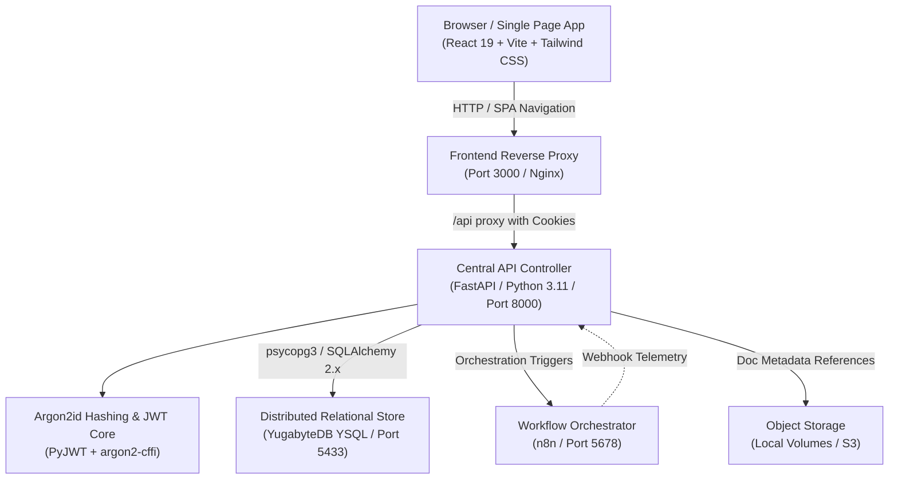
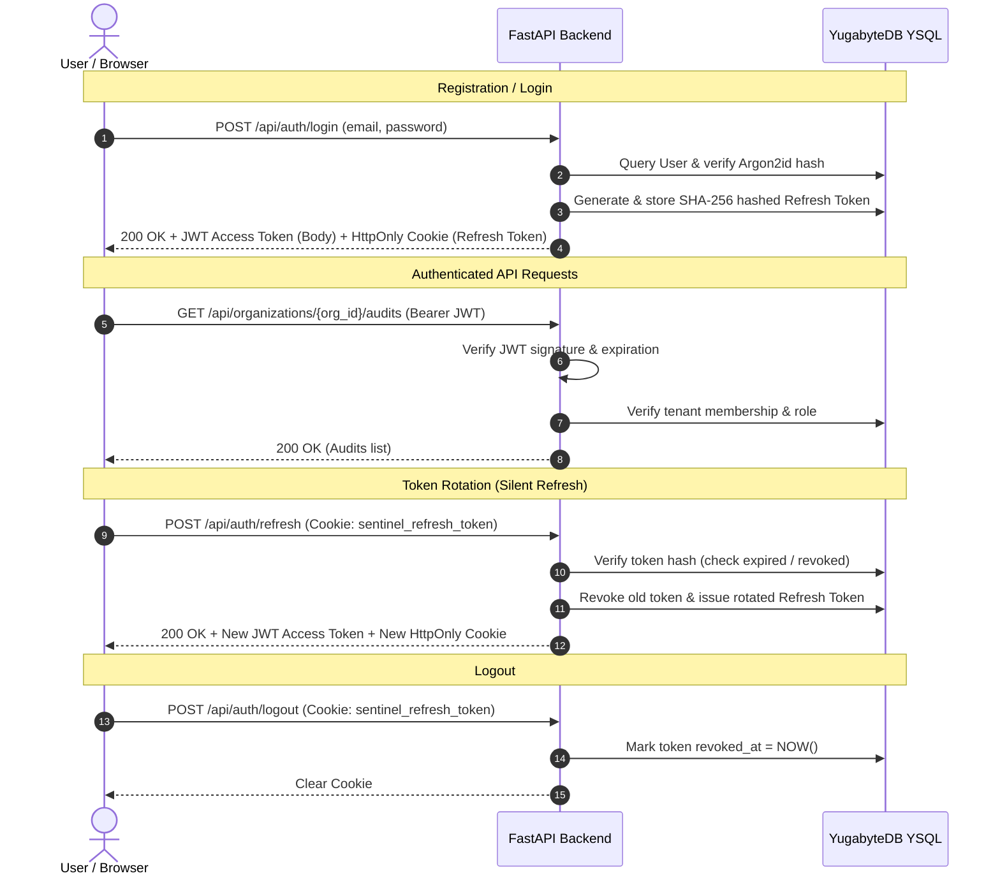

# Compliance Sentinel — Security Posture & Compliance SaaS

**Compliance Sentinel Enterprise v4.0** is an enterprise-grade multi-tenant AI-powered compliance auditing platform. It monitors and validates infrastructure and application workloads against global regulatory frameworks (SOC 2, ISO 27001, HIPAA, PCI-DSS, NIST CSF, EU AI Act) using an ensemble of autonomous LLM auditor models.

---

## 1. System Architecture Overview



- **Frontend**: React 19, Vite, TypeScript, Tailwind CSS, Lucide Icons, served via Nginx with HTML5 push-state routing and API reverse-proxying.
- **Backend API**: Python 3.11, FastAPI, Pydantic v2, dependency injection for database sessions and RBAC.
- **Authentication**: Argon2id password hashing, short-lived signed JWT access tokens, and cryptographically hashed refresh tokens transported via `HttpOnly`, `SameSite=Lax` cookies.
- **Database**: YugabyteDB YSQL (PostgreSQL 15-compatible distributed relational database).
- **ORM & Migrations**: SQLAlchemy 2.x typed `Mapped` declarative models + Alembic.
- **Workflow Orchestration**: n8n service (isolated from frontend; all orchestration coordinated via FastAPI).
- **Containerization**: Docker Compose with multi-stage image builds, named persistent volumes, service health checks, and a bridge network.

---

## 2. Authentication, Tenancy & RBAC (Milestone 2)

### 2.1 Security & Session Lifecycle



### 2.2 Supported Organization Roles

| Role | Permissions & Capabilities |
|---|---|
| **`owner`** | Full administrative control. Can create/manage audits, provision runs, manage organization settings, invite/remove members, and assign/demote other owners. Cannot be demoted or removed if they are the last owner. |
| **`admin`** | User management and audit administration. Can manage non-owner members, update organization name, and create/manage audits and runs. Cannot promote themselves to owner. |
| **`auditor`** | Operational audit specialist. Can create audits, update audit configurations, dispatch audit execution runs, and view reports. |
| **`analyst`** | Read access to audits and runs; can manage findings, evidence, and adjudication responses. |
| **`viewer`** | Strictly read-only access to organization audits, compliance dashboards, telemetry, and reports. |

---

## 3. API Endpoints Reference

### 3.1 Authentication (`/api/auth`)

#### `POST /api/auth/register`
Creates a user, organization, and owner membership in a single transactional unit. Sets `HttpOnly` refresh cookie.
```json
// Request Body
{
  "full_name": "Elena Vance",
  "email": "elena.vance@acme-financial.com",
  "password": "SecurePassword2026!",
  "organization_name": "Acme Financial Global"
}

// Response: 201 Created
{
  "access_token": "eyJhbGciOi...",
  "token_type": "bearer",
  "expires_in": 1800,
  "user_id": "7839d873-65f6-4b87-91f4-2d0729e43d44",
  "email": "elena.vance@acme-financial.com",
  "full_name": "Elena Vance",
  "organization_id": "3f24ed73-3817-470f-adb7-005ecd7069c9",
  "organization_name": "Acme Financial Global",
  "role": "owner"
}
```

#### `POST /api/auth/login`
Authenticates credentials with Argon2id and returns an access token + sets refresh cookie.
```json
// Request Body
{
  "email": "elena.vance@acme-financial.com",
  "password": "SecurePassword2026!"
}
```

#### `GET /api/auth/me`
Returns current user profile and array of active tenant memberships.
```json
// Headers: Authorization: Bearer <access_token>
// Response: 200 OK
{
  "id": "7839d873-65f6-4b87-91f4-2d0729e43d44",
  "email": "elena.vance@acme-financial.com",
  "full_name": "Elena Vance",
  "is_active": true,
  "organizations": [
    {
      "organization_id": "3f24ed73-3817-470f-adb7-005ecd7069c9",
      "organization_name": "Acme Financial Global",
      "organization_slug": "acme-financial-global",
      "role": "owner"
    }
  ]
}
```

#### `POST /api/auth/refresh`
Rotates refresh tokens and returns a fresh access token. Protects against token reuse.

#### `POST /api/auth/logout`
Revokes active refresh session in the database and clears the browser cookie.

---

### 3.2 Organization Management (`/api/organizations`)

- `GET /api/organizations` — List organizations the user belongs to.
- `POST /api/organizations` — Create a new organization (requesting user becomes `owner`).
- `GET /api/organizations/{org_id}` — Get organization metadata (requires membership).
- `PATCH /api/organizations/{org_id}` — Update organization details (`owner`, `admin`).
- `GET /api/organizations/{org_id}/members` — List members and their roles.
- `POST /api/organizations/{org_id}/members` — Add a registered user to the organization.
- `PATCH /api/organizations/{org_id}/members/{user_id}` — Update member role (enforces last-owner & self-promotion guardrails).
- `DELETE /api/organizations/{org_id}/members/{user_id}` — Remove member from organization.

---

### 3.3 Audit & Run Management (`/api/organizations/{org_id}/audits`)

- `POST /api/organizations/{org_id}/audits` — Create an audit case (`owner`, `admin`, `auditor`).
- `GET /api/organizations/{org_id}/audits` — List audits with pagination (`page`, `size`), text search (`search`), and status filter (`status`).
- `GET /api/organizations/{org_id}/audits/{audit_id}` — Retrieve audit details, execution metrics, and run summary.
- `PATCH /api/organizations/{org_id}/audits/{audit_id}` — Update audit properties.
- `DELETE /api/organizations/{org_id}/audits/{audit_id}` — Soft-delete / archive audit preserving run history.
- `POST /api/organizations/{org_id}/audits/{audit_id}/runs` — Allocate next sequential `run_number` and queue execution.
- `GET /api/organizations/{org_id}/audits/{audit_id}/runs` — List all execution runs ordered by `run_number DESC`.
- `GET /api/organizations/{org_id}/audits/{audit_id}/runs/{run_id}` — Retrieve details of a specific execution run.

---

## 4. Frontend Application Features

- **Enterprise Login (`/login`)**: High-contrast, accessibility-tested authentication UI matching Compliance Sentinel brand aesthetics.
- **Organization Registration (`/register`)**: Self-serve workspace onboarding with real-time validation and instant credential generation.
- **Session Restoration & Auto-Refresh**: Seamless token lifecycle via centralized `apiClient` interceptor with queued retries on 401.
- **Multi-Tenant Workspace Switcher**: Quick dropdown in top navbar and sidebar allowing instant switching across tenant contexts.
- **Audit Case Dispatcher**: Modal dialog connecting directly to `POST /api/organizations/{org_id}/audits` and dispatching the first sequential run.
- **Live Audits Table**: Real-time assessments table connected to live YugabyteDB partitions, with server-side pagination, search, and empty state workflows.

---

## 5. Automated Testing Suite

All 21 backend unit, integration, and security test cases execute against the live YugabyteDB YSQL instance:

```bash
# Run the complete test suite
PYTHONPATH=backend backend/venv/bin/pytest backend/tests/ -v
```

### Test Coverage Highlights:
- **`test_auth_api.py`**:
  - Registration with Argon2id password verification.
  - Conflict handling for duplicate user registrations.
  - Login credential validation, bad password rejection, inactive user block.
  - `/api/auth/me` user profile and multi-tenant membership checks.
  - Refresh token rotation and cryptographic reuse revocation.
  - Logout cookie clearing and database session invalidation.
- **`test_audit_api.py`**:
  - Multi-tenant organization CRUD and slug generation.
  - RBAC checks for owner, admin, auditor, analyst, and viewer roles.
  - Last-owner demotion & removal prevention guardrails.
  - Audit case creation, filtering, searching, and pagination.
  - Concurrent-safe incremental run number allocation (`run_number = 1, 2, ...`).
  - Cross-tenant isolation verification (attempted cross-tenant access returns `404 Not Found`).
- **`test_database_schema.py` & `test_tenant_isolation.py`**:
  - 20-table schema verification.
  - Composite foreign key constraint integrity.
  - Cross-tenant reference rejection by database triggers.

---

## 6. Running with Docker Compose

```bash
# 1. Clone repository and copy environment template
cp .env.example .env

# 2. Build and launch all services
docker compose up -d

# 3. Check health and container statuses
docker compose ps

# 4. View live logs
docker compose logs -f backend
docker compose logs -f frontend
```

### Exposed Service Endpoints:
- **Frontend SPA**: `http://localhost:3000` (Nginx + React 19)
- **FastAPI Documentation**: `http://localhost:8000/docs` (Swagger UI)
- **FastAPI Health Check**: `http://localhost:8000/api/health`
- **YugabyteDB YSQL**: `localhost:5433` (PostgreSQL wire protocol)
- **YugabyteDB Admin Web UI**: `http://localhost:15433`
- **n8n Workflow Automation**: `http://localhost:5678`
